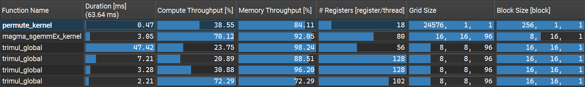

# Trimat — CUDA 算子优化

从朴素的逐元素点积，到共享内存分块，记录因果注意力三角矩阵乘（Causal Attention Q@Kᵀ）的 4 个手写内核迭代过程，并以 cuBLAS 全矩阵 GEMM 作为对照基准。

---

## 算子简介

自回归注意力的第一步是计算注意力分数矩阵：

```
S = Q @ Kᵀ × (1/√HS)
```

- 输入 `inp` 维度为 `(B, T, 3, NH, HS)`，即投影后打包好的 QKV 合并张量；
- 输出 `preatt` 维度为 `(B, NH, T, T)`，每个样本、每个注意力头一个 `T×T` 分数矩阵；
- 元素含义：`S[b,h,i,j]` 是第 `i` 个 token 的 Query 与第 `j` 个 token 的 Key 的点积相似度，值越大表示越关注。

因果掩码要求：当前 token 只能看见自己和历史 token，即**只有下三角（含对角线）有效**，上三角（未来位置）应为 `-inf`。

通用做法是「完整 GEMM + 单独掩码」：算出完整 `T×T` 矩阵，再把上三角置为 `-inf`。

本算子把掩码**融合进矩阵乘内部**，直接跳过整块上三角：

```
完整矩阵输出数：T² 个
下三角输出数：  T(T+1)/2 个 ≈ T²/2     ← 理论有效计算量省一半
```

> 与 Softmax 等访存密集型算子不同，这是 GEMM 型算子：每个输出元素要做 `HS` 次乘加（算术强度随 `HS` 增长），理论上是计算密集型。但在本配置（`HS=64`、96 个批量×头）下，计算密度不大，优化过程就是从「内存受限」逐步推进到「计算/内存均衡」。

---

## 性能总览

> 本仓库测试基准全环境统一，所有性能数据均采集自 Nsight Compute（`ncu --set full --cache-control all`）。NCU 单次采集含硬件计数器采样开销，绝对耗时略高于干净执行，跨版本结论基于同口径下的相对比较与硬件利用率指标。（详见根目录 README）
>
> 默认测试配置：FP32，`B=8`，`T=1024`，`C=768`，`NH=12`，`HS=64`。测试过程重复 100 次取平均



| 版本 | 核心实现 | 耗时 (ms) | Compute (%) | Memory (%) | 寄存器 | Grid Size | Block Size |
|:---:|---|:---:|:---:|:---:|:---:|:---:|:---:|
| v0 | cuBLAS：permute + gemm（全矩阵） | 3.52（0.47 + 3.05） | 70.12 | 92.05 | 80 | 16,16,96 | 8,16,1 |
| v1 | 朴素移植：每线程 8×8 逐点积 | 47.42 | 23.75 | 98.24 | 56 | 8,8,96 | 16,16,1 |
| v2 | 寄存器复用：循环重排，lhs[8]×rhs[8] | 7.21 | 20.89 | 88.51 | 128 | 8,8,96 | 16,16,1 |
| v3 | float4 向量化加载 + 写回 | 3.28 | 30.88 | 96.20 | 128 | 8,8,96 | 16,16,1 |
| v4 | 共享内存 128×32 分块 | 2.21 | 72.29 | 72.29 | 102 | 8,8,96 | 16,16,1 |

> v0 实际启动两个 kernel：`permute_kernel`（0.47ms）和 cuBLAS 内部的 `magma_sgemmEx_kernel`（3.05ms，GEMM 内核）。
>
> v1~v4 每个 kernel 只启动一个 `trimul_global`，Grid 的 z = B×NH = 96，每个 (x,y) 块负责一个 128×128 输出区域。

---

<br>

## v0 — cuBLAS 基准：全矩阵 GEMM + 前置 permute

### 整体流程

```
1. 打包输入 inp (B,T,3,NH,HS)
2. 先用 permute_kernel 维度重排 + 拆分成三个独立张量 q/k/v (B,NH,T,HS)
3. cublasSgemmStridedBatched：B*NH 个小 GEMM 并行
4. 完整输出 preatt (B,NH,T,T) —— 含上三角，cuBLAS 不做因果跳过
```

### 为何先做 permute（维度重排）

`cublasSgemmStridedBatched` 要求 Q/K/V 是三个独立、连续的张量，且批量维度在前——每个头的 `(T,HS)` 小矩阵必须在内存里连续，才能被当成一个批量。

打包输入 `(B,T,3,NH,HS)` 不满足，所以先用 `permute_kernel` 拆成三份（额外占用一块 `B*T*3*C` 的显存缓冲区）。

### 列优先的坑：交换 K/Q 白嫖一次转置

cuBLAS 是列优先存储，C 代码是行优先。为了不再跑一个转置 kernel，传参时刻意把 K 放在前、Q 放在后，并对 K 标记转置：

```cuda
// 1. 维度重排：(B,T,3,NH,HS) → 三个独立 (B,NH,T,HS)
permute_kernel<<<num_blocks, 256>>>(q, k, v, inp, B, T, NH, HS);

// 2. 批量 GEMM：B*NH 个 (T,HS)@(HS,T) = (T,T)
const float alpha = 1.0f / sqrtf(HS);   // 1/√HS 缩放直接作为 alpha 融合，省一趟全矩阵遍历
cublasSgemmStridedBatched(cublas_handle,
                          CUBLAS_OP_T, CUBLAS_OP_N,   // K 转置、Q 不转
                          T, T, HS,
                          &alpha,
                          k, HS, T * HS,
                          q, HS, T * HS,
                          &beta,
                          preatt, T, T * T,
                          B * NH);
```

看似在算 `Kᵀ @ Q`，但点积交换律 + 列优先输出布局，恰好等于行优先想要的 `Q @ Kᵀ`，零额外转置。

### 特点（与手写内核的区别）

1. **无三角优化**：算完整 `T×T`，上三角约一半算力被浪费，之后还要再次掩码；
2. **额外搬运消耗**：前置 permute 实测 0.47ms，占用一块临时缓冲区；
3. **通用极致优化**：GEMM 内核性能非常高，是手写内核的参照标尺；
4. **缩放因子融合**：直接把注意力的 1/√HS 缩放作为 alpha 参数融合到矩阵乘法里，不用额外再做一次全矩阵缩放

<br>

---

## 手写内核通用框架：模板 + 8×8 线程块

v1~v4 共用同一套调度框架（模板 + 函数指针），差异只封装在「一个线程如何算自己的 8×8 输出块」里。

- **Block 划分**：把 `T×T` 输出切成 128×128 的大块，Grid = `(T/128, T/128, B*NH)`；
- **线程划分**：Block = `(16, 16)` = 256 线程，每个线程负责 8×8 个输出（16×8=128）；
- **块级因果跳过**：`blockIdx.y > blockIdx.x` 的块整个位于上三角，直接 return，省掉约一半的块；
- **批量并行**：`B×NH` 放在 Grid 的 z 轴，所有样本和头完全独立。

```cuda
using matmul_fn_ptr = void(*)(float* p, int PS, const float* k, int KS,
                              const float* q, int QS, int T, int HS, float alpha);

template<matmul_fn_ptr matmul_tri>
__global__ void __launch_bounds__(256, 2) trimul_global(float* out, const float* inp,
                                                        int T, int C, int NH) {
    if (blockIdx.y > blockIdx.x) return;        // 块级掩码：整块在上三角直接退出
    int C3 = C * 3, HS = C / NH;
    float scale = 1.0f / sqrtf(HS);
    // 将「批次 B × 注意力头 NH」维度放到 block 的 z 轴索引上
    int b  = blockIdx.z / NH;
    int nh = blockIdx.z % NH;
    // 直接从打包输入定位 Q/K 基址，无需 permute
    const float* q = inp + b * T * C3 + nh * HS;
    const float* k = inp + b * T * C3 + nh * HS + C;
    float* r = out + (b*NH + nh) * T * T;
    matmul_tri(r, T, k, C3, q, C3, T, HS, scale);  // 具体算法由模板参数注入
}
```

<br>

---

## v1 — 朴素实现：每线程 8×8 逐点积

直接照搬 CPU 逻辑：每个线程串行算 64 个输出，每个输出独立做一次 `HS` 维点积。

```cuda
__device__ void matmul_tri_naive(float* p, int PS, const float* k, int KS,
                                 const float* q, int QS, int T, int HS, float alpha) {
    int i_base = blockIdx.x * 128 + threadIdx.x * 8;
    int j_base = blockIdx.y * 128 + threadIdx.y * 8;
    if (j_base > i_base) return;
    for (int io = 0; io < 8; ++io) {
        int i = i_base + io;
        for (int jo = 0; jo < 8; ++jo) {
            int j = j_base + jo;
            float val = 0;
            for (int hs = 0; hs < HS; ++hs)
                val += q[i * QS + hs] * k[j * KS + hs];   // 64 个元素各自独立点积
            p[i * PS + j] = val * alpha;
        }
    }
}
```

**问题**

- **Q/K 行被重复读取**：算 8 个输出列时，同一 Q 行被读 8 次；算 8 个输出行时，同一 K 行被读 8 次。
- **公共维度在最内层**：每次点积都要从全局内存重新发起读，访存延迟无法被计算掩盖。

> Memory Throughput **98.24%**、Compute 仅 23.75%——DRAM 带宽已经被打满，计算单元大量时间在干等数据，典型的内存受限。

<br>

---

## v2 — 循环重排 + 寄存器复用

**设计思路**

v1 的点积顺序是「按输出元素组织」，每算一个元素读两行。

v2 把循环顺序改成「按公共特征维 `hs` 组织」：
1. 对每个特征维 `hs`，把 8 个 Q 行和 8 个 K 行的该维元素一次性加载到寄存器数组 `lhs[8]` / `rhs[8]`；
2. 在寄存器内完成 8×8 = 64 次乘加累加；
3. 走完整个 `HS` 后统一写回。

这样每个 Q/K 元素从全局显存只读 **1 次**，却在寄存器中被复用 8 次，读取量降到 v1 的 1/8。

```cuda
__device__ void matmul_tri_registers(float* p, int PS, const float* k, int KS,
                                     const float* q, int QS, int T, int HS, float alpha) {
    int i_base = blockIdx.x * 128 + threadIdx.x * 8;
    int j_base = blockIdx.y * 128 + threadIdx.y * 8;
    if (j_base > i_base) return;
    // 将指针偏移到当前线程负责区域的位置
    q += i_base * QS; 
    k += j_base * KS;
    p += i_base * PS + j_base;

    float vals[8][8] = {};               // 8×8 结果常驻寄存器
    for (int hs = 0; hs < HS; ++hs) {    // 外层公共维度循环
        float lhs[8];
        float rhs[8];
        for (int u = 0; u < 8; ++u) {
            lhs[u] = q[u * QS + hs];     // 一次读 8 个 Q 行的当前特征维
            rhs[u] = k[u * KS + hs];     // 一次读 8 个 K 行的当前特征维
        }
        // 寄存器内完成 8×8=64 次乘加累加
        for (int i = 0; i < 8; ++i)
            for (int j = 0; j < 8; ++j)
                vals[i][j] += lhs[i] * rhs[j];
    }

    // 写回 64 个结果
    for (int i = 0; i < 8; ++i) {
        for (int j = 0; j < 8; ++j) {
            p[i * PS + j] = vals[i][j] * alpha;
        }
    }
}
```

**性能表现**：47.42ms → 7.21ms，快约 6.6 倍。

**标量加载**：每次只读 1 个 float，没有完善带宽问题（Memory 88.51%），下版本解决。

**寄存器上限**：128 寄存器/线程，恰好是 "`__launch_bounds__(256, 2)`：128 寄存器/线程" 的编译器分配上限，若再扩大单线程负责的元素数量，就会压低占用率。

<br>

---

## v3 — float4 向量化：把 128 位合并访存打满

**设计思路**

v2 的计算部分已无浪费，瓶颈在访存指令的合并度。

v3 改用 `float4`：一次加载/存储 4 个连续 float（16 字节），让 Warp 内的访问拼成连续的 128 位块，硬件可以完美合并；访存指令数同时降到 1/4。

向量化只能在内存连续的维度做：这里最内层特征维 `hs` 连续，所以循环步长改为 4；`u` 行方向是跨步的，不能向量化。

```cuda
// 步长从 1 变成 4，一次处理 4 个特征维
for (int hs = 0; hs < HS; hs += 4) {
    float4 rhs[8];     // 数据类型：float4
    for (int u = 0; u < 8; ++u)
        rhs[u] = ld_vec(k + u * KS + hs);     // 一次加载 K 行的 4 个连续特征维
    for (int i = 0; i < 8; ++i) {
        float4 lhs = ld_vec(q + i * QS + hs); // Q 行只在 i 循环内加载
        for (int j = 0; j < 8; ++j) {
            vals[i][j] += lhs.x * rhs[j].x;
            vals[i][j] += lhs.y * rhs[j].y;
            vals[i][j] += lhs.z * rhs[j].z;
            vals[i][j] += lhs.w * rhs[j].w;
        }
    }
}
// 写回同样 float4 向量化（j += 4，st_vec）
for (int i = 0; i < 8; ++i) {
    for (int j = 0; j < 8; j += 4) { // 列步长改为 4，一次写 4 个连续输出元素
        float4 result;
        result.x = vals[i][j + 0] * alpha;
        result.y = vals[i][j + 1] * alpha;
        result.z = vals[i][j + 2] * alpha;
        result.w = vals[i][j + 3] * alpha;
        st_vec(p + i * PS + j, result);
    }
}
```

> Q 的 `lhs` 放在 `i` 循环内而不是和 `rhs` 一起放外层：它只在当前行的 8 次列循环里复用，用完即弃。若放外层需要 8 个 float4（32 个寄存器），现在只需 1 个（4 个寄存器），省 28 个寄存器且复用次数不变。

**性能**：7.21ms → 3.28ms，快约 2.2 倍。

**问题**：Memory 仍高达 96.20%，数据还是直接从全局显存读，每一遍 `hs` 循环都要重新搬 Q/K。线程块没有在更快的存储层级上复用。

<br>

---

## v4 — 共享内存分块：计算与访存达到均衡

**设计思路**

把公共维度 `HS` 按 32 个元素切成多个分片，

每个分片先由 Block 的全部线程一起加载到共享内存，

计算阶段再全部从共享内存读，不碰全局显存。

- 共享内存延迟约 20~30 周期，远低于全局显存；
- 128×128 输出块对应的 128 行 Q + 128 行 K，每次只载入 32 维分片，逐片累加。

```cuda
__device__ void matmul_tri4(float* p, int PS, const float* k, int KS, const float* q, int QS, int T, int HS, float alpha) {
    int i_base = blockIdx.x * 128 + threadIdx.x * 8;   // 本线程负责的 8 个 Q 行
    int j_base = blockIdx.y * 128 + threadIdx.y * 8;   // 本线程负责的 8 个 K 
    // 块级掩码：整块都在上三角才退出。不能像 v1~v3 那样在顶部做 8×8 线程级退出（原因下面讲）。
    if (blockIdx.y > blockIdx.x) return;
    // 指针平移到整个线程块负责的 128 行起始位置（不再是本线程的 8 行），加载阶段搬的是整块数据
    q += blockIdx.x * 128 * QS;
    k += blockIdx.y * 128 * KS;
    __shared__ float lhs_s[128][32];   // 128 个 Q 行的 32 维分片
    __shared__ float rhs_s[128][32];   // 128 个 K 行的 32 维分片
    float vals[8][8] = {};             // 8×8 部分和常驻寄存器，所有分片累加完就是最终结果

    // 公共维度 HS 被拆成多个 32 维的块，每次处理一个 32 维分片，逐块加载到共享内存计算
    for (int so = 0; so < HS; so += 32) {
        // 阶段一：全线程协作加载
        __syncthreads();
        for (int y = threadIdx.y / 2; y < 128; y += 8) {
            int xo = (threadIdx.y % 2) * 16;   // 同组两个线程分别搬一行的 前/后 各16列
            lhs_s[y][threadIdx.x + xo] = q[y * QS + so + threadIdx.x + xo];
            rhs_s[y][threadIdx.x + xo] = k[y * KS + so + threadIdx.x + xo];
        }
        __syncthreads();

        // 阶段二：全部从共享内存取数做 8×8 部分点积，不再碰全局显存
        for (int si = 0; si < 32; ++si) {
            float rhs[8];
            for (int u = 0; u < 8; ++u)
                // (threadIdx.x + si) % 32：把 warp 内 32 个线程访问的列打散到不同 bank，避免冲突
                rhs[u] = rhs_s[threadIdx.y * 8 + u][(threadIdx.x + si) % 32];
            for (int ii = 0; ii < 8; ++ii) {
                float lhs = lhs_s[threadIdx.x * 8 + ii][(threadIdx.x + si) % 32];
                for (int ji = 0; ji < 8; ++ji)
                    vals[ii][ji] += lhs * rhs[ji];
            }
        }
    }

    // 阶段三：写回。所有计算完成之后才做 8×8 线程级因果判断
    // 不写入对角线以上的区域（此时加载和计算都做完了，不需要无效线程参与了，才做 8×8 线程级的因果掩码判断：完全在上三角的区域直接返回，不写结果）
    if (j_base > i_base) return;
    for (int ii = 0; ii < 8; ++ii) {
        for (int ji = 0; ji < 8; ji += 4) {
            int i = i_base + ii;
            int j = j_base + ji;
            float4 result;
            result.x = vals[ii][ji + 0] * alpha;
            result.y = vals[ii][ji + 1] * alpha;
            result.z = vals[ii][ji + 2] * alpha;
            result.w = vals[ii][ji + 3] * alpha;
            st_vec(p + i * PS + j, result);   // float4 向量化写回
        }
    }
}
```

> **加载阶段线程不能提前退出**：  
> v1~v3 每个线程只管自己的活，顶部用 `if (j_base > i_base) return;` 退出不影响别人；  
> v4 的加载是整个 block 全部线程一起搬，每线程固定负责总数据的一部分，谁退出，那些数据就没人搬。  
> 且 `__syncthreads()` 是整块栅栏，部分线程提前 return 会让剩余线程永远等不到（死锁）。  
> 所以 v4 顶部只能做块级退出，8×8 线程级的判断要推迟到计算完、写回前。

**性能表现**: 

3.28ms → 2.21ms，快约 1.5 倍。

Compute / Memory 同时达到 72.29% / 72.29%，从 v1~v3 的内存受限，推进到计算与访存均衡。

端到端耗时跑赢 cuBLAS：matmul_tri4 **2.21ms** vs cuBLAS gemm **3.05ms**（cuBLAS 若算上 permute 则是 3.52ms）。

---

<br>

## v4 是怎么「赢」cuBLAS 的

v4 端到端更快，但要分清它赢在哪里：

1. **计算量口径不同**：cuBLAS 算全矩阵 **12.88 GFLOPs**；手写核只算下三角，有效 **6.45 GFLOPs**（约一半）。
2. **单设备吞吐 cuBLAS 仍然更高**：gemm 12.88 GFLOPs / 3.05ms ≈ **4.2 TFLOPS**；v4 有效 6.45 GFLOPs / 2.21ms ≈ **2.9 TFLOPS**（NCU 口径）。
3. **手写核赢在工作量和融合**：只算一半 + 直接适配打包输入（省掉 0.47ms 的 permute），端到端耗时反超。

---

<br>

## 后续优化方向

1. **Tensor Core**：用 WMMA/CUTLASS 让 GEMM 走张量核（FP16/BF16 或 TF32），同时在输出阶段应用三角掩码；这是另一条路径。
2. **算子融合**：三角矩阵乘天然位于 Softmax 之前，与 `softmax`、`@V` 融合进 SRAM 即 Flash Attention，可彻底消除 `T×T` 分数矩阵的全局内存往返，见本仓库 attention 目录。
